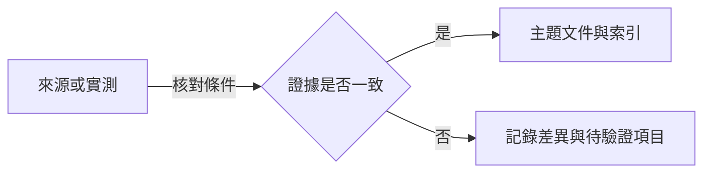

# 黑夜君臨研究資料庫

- 集中記錄《艾爾登法環 黑夜君臨》（ELDEN RING NIGHTREIGN）的能力值、遊戲機制與研究來源。
- 網站內容位於 `public/`；Netlify 依 `netlify.toml` 直接發佈該目錄，不需建置指令。

## 頁面

| 檔案 | 內容 |
| --- | --- |
| [public/index.html](public/index.html) | 研究索引。 |
| [public/attributes.html](public/attributes.html) | 能力值涵義表。 |

## 資料記錄方式

- 新主題在 `public/` 新增頁面，並在 `public/index.html` 的研究索引表新增一列。
- 各主題附來源、查閱日期與適用範圍；區分官方說明、社群資料及尚未解決的問題。
- 有數值的結論記錄作用條件；實測記錄遊戲版本、角色、等級、裝備與可重現步驟。
- 官方更新公告用來追蹤變更；涉及舊版資料時重新核對，不以查閱日期代替遊戲版本。

