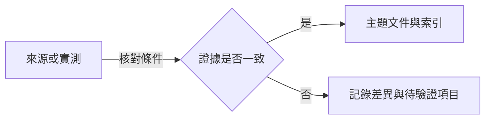

# 黑夜君臨研究資料庫

- 集中記錄《艾爾登法環 黑夜君臨》（ELDEN RING NIGHTREIGN）的能力值、遊戲機制與研究來源。

## 目錄

- [研究索引](#研究索引)
- [資料記錄方式](#資料記錄方式)

## 研究索引

| 主題 | 內容 |
| --- | --- |
| [能力值涵義表](docs/attributes.md) | 能力值選單的 12 項名稱、主要用途、遺物數值例子及查證限制。 |

[回到目錄](#目錄)

---

## 資料記錄方式

- 各主題附來源、查閱日期與適用範圍；區分官方說明、社群資料及尚未解決的問題。
- 有數值的結論記錄作用條件；實測記錄遊戲版本、角色、等級、裝備與可重現步驟。
- 官方更新公告用來追蹤變更；涉及舊版資料時重新核對，不以查閱日期代替遊戲版本。

[回到目錄](#目錄)

---
