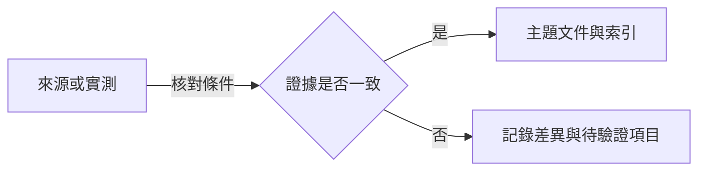

# 黑夜君臨研究資料庫

- 集中記錄《艾爾登法環 黑夜君臨》（ELDEN RING NIGHTREIGN）的能力值、遊戲機制與研究來源。
- 網站原始碼位於 `public/`；發佈前在本機建置成含完整內容的靜態頁 `dist/`，連同原始碼一起 commit。Netlify 依 `netlify.toml` 直接發佈 `dist/`，不執行建置指令。
- 第一次 clone 後執行 `git config core.hooksPath .githooks`，啟用 push 到 `main` 前的檢查 ([.githooks/pre-push](.githooks/pre-push))。
- 建置 (需要 Node.js)：第一次先 `npm --prefix tools ci` 安裝依賴，之後 `npm --prefix tools run build` 產生 `dist/`；`npm --prefix tools run check` 檢查 `dist/` 是否與原始碼一致。
- 本機預覽：`python -m http.server -d dist` 預覽發佈的頁面；`python -m http.server -d public` 預覽未建置的模板 (由瀏覽器載入資料渲染)。再開啟 `http://localhost:8000/`。直接開啟本機檔案時，模板無法顯示數值，`dist/` 的角色頁圖表與法術錨點轉址也無法運作。

## 頁面

| 檔案 | 內容 |
| --- | --- |
| [public/index.html](public/index.html) | 研究索引，依主題分組，並集中列出全站資料來源。 |
| [public/attributes.html](public/attributes.html) | 遊戲屬性：能力值與 HP、FP、精力上限的主要用途及查證限制。 |
| [public/relics-general.html](public/relics-general.html) | 遺物詞條：遊戲內篩選「一般」大類。 |
| [public/relics-character.html](public/relics-character.html) | 遺物詞條：遊戲內篩選「角色專屬」大類。 |
| [public/relics-armament.html](public/relics-armament.html) | 遺物詞條：遊戲內篩選「武器專屬」大類。 |
| [public/relics-demerit.html](public/relics-demerit.html) | 遺物詞條：遊戲內篩選「負面效果」大類。 |
| [public/data/common.json](public/data/common.json) | 所有頁面共用的遊戲版本、能力值、圖示、角色、標籤與來源。 |
| `public/data/relics/<category>.json` | 遊戲內遺物篩選各大類 (`general`、`character`、`armament`、`demerit`) 的分類定義與遺物效果，由產生腳本輸出。 |
| [public/render.js](public/render.js) | 依頁面宣告載入資料檔並填入頁面佔位元素、產生遺物詞條表；建置時產生靜態內容；瀏覽器開啟 `dist/` 時只處理角色頁圖表與錨點，開啟 `public/` 模板時在瀏覽器完整渲染。 |
| [public/nav.js](public/nav.js) | 在固定頁首顯示讀者目前所在的頁面、章節與小節；預設收起各章節，提供全部展開與全部收合。 |
| [tools/build-site.mjs](tools/build-site.mjs) | 以 jsdom 執行 render.js，把 `public/` 建置成 `dist/`；`--check` 只比對不寫檔。 |
| `dist/` | 建置產物，即 Netlify 發佈的內容，不手動編輯。 |
| [.githooks/pre-push](.githooks/pre-push) | push 到 `main` 前確認 `dist/` 是目前原始碼的建置結果。 |
| [tools/import-relics.mjs](tools/import-relics.mjs) | 由鎖定版本的遊戲參數、遊戲文字與社群資料集產生 `public/data/relics/*.json`，不在網站上發佈。 |

## 資料記錄方式

- 新主題在 `public/` 新增頁面，並在 `public/index.html` 對應主題的章節新增一列。
- 遊戲數值記錄在 `public/data/` 的資料檔，頁面模板不寫死數值；修改原始碼或資料後重新建置 `dist/`。
- 遺物詞條資料 `public/data/relics/*.json` 以 `node tools/import-relics.mjs` 產生 (需要 Node.js)，不手動編輯；規則見 [LORE_ch.md](LORE_ch.md)。
- 各主題附來源、查閱日期與適用範圍；區分官方說明、社群資料及尚未解決的問題。
- 有數值的結論記錄作用條件；實測記錄遊戲版本、角色、等級、裝備與可重現步驟。
- 官方更新公告用來追蹤變更；涉及舊版資料時重新核對，不以查閱日期代替遊戲版本。

