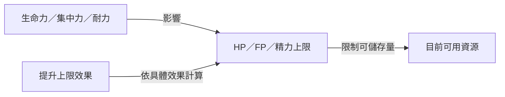

# 能力值涵義表

- 適用遊戲：《艾爾登法環 黑夜君臨》（ELDEN RING NIGHTREIGN）。
- 範圍：能力值篩選選單中的全部 12 項，依提供的繁體中文畫面排序；本表說明主要用途，不是所有隱藏防禦、抗性或傷害公式的完整清單。
- 查閱日期：2026-10-10。官方手冊用於基本機制，社群資料用於能力值及遺物細節；未以本機遊戲實測確認特定更新版本。

## 目錄

- [能力值對照表](#能力值對照表)
- [如何理解提升效果](#如何理解提升效果)
- [數值例子](#數值例子)
- [查證限制](#查證限制)
- [資料來源](#資料來源)

## 能力值對照表

| 畫面名稱 | 英文對照 | 主要涵義 | 閱讀重點 | 來源 |
| --- | --- | --- | --- | --- |
| 提升 HP 上限 | Increased Maximum HP | 增加生命量表可容納的上限；HP 是受傷時消耗的生存資源。 | 名稱表示效果目標，不能只靠名稱判斷固定值或百分比。 | [官方量表說明][hud]、[遺物效果][relic] |
| 提升 FP 上限 | Increased Maximum FP | 增加 FP 容量，供需要 FP 的戰技、魔術及禱告使用。 | FP 上限與法術攻擊力是不同項目。 | [官方量表說明][hud]、[遺物效果][relic] |
| 提升精力上限 | Increased Maximum Stamina | 增加精力量表容量，支應攻擊、迴避等消耗精力的動作。 | 上限與回復速度分開看；官方手冊說明非交戰狀態不消耗精力。 | [官方量表說明][hud]、[效果總表][effects] |
| 生命力 | Vigor / VIG | 決定 HP 上限的基礎能力值。 | 遺物的「生命力 +1」是能力值增加 1，對應的 HP 增量另見下表。 | [能力值定義][attributes]、[遺物效果][relic] |
| 集中力 | Mind / MND | 決定 FP 上限的基礎能力值。 | 增加可用 FP 容量。 | [能力值定義][attributes] |
| 耐力 | Endurance / END | 決定精力上限的基礎能力值。 | 本作裝備重量不造成移動或迴避懲罰，不應套用本篇的負重配點思路。 | [能力值定義][attributes]、[官方入門指南][starter] |
| 力氣 | Strength / STR | 提升具有力氣補正之武器的攻擊力。 | 看武器的補正欄，不能僅憑武器外觀或大小判斷收益。 | [能力值定義][attributes]、[官方入門指南][starter] |
| 靈巧 | Dexterity / DEX | 提升具有靈巧補正之武器的攻擊力；也參與施法速度。 | 社群施法資料另區分實際靈巧與施法速度效果提供的「虛擬靈巧」。 | [能力值定義][attributes]、[施法速度說明][casting] |
| 智力 | Intelligence / INT | 提升具有智力補正之武器的攻擊力，是法杖施放魔術的重要能力值。 | 依武器／法杖補正判讀，不把智力等同於 FP 容量。 | [能力值定義][attributes]、[法術與法器整理][catalysts] |
| 信仰 | Faith / FAI | 提升具有信仰補正之武器的攻擊力，是聖印記施放禱告的重要能力值。 | 依武器／聖印記補正判讀。 | [能力值定義][attributes]、[聖印記補正討論][seals] |
| 感應 | Arcane / ARC | 提升具有感應補正之武器的攻擊力，並影響毒、出血等適用攻擊的異常狀態累積。 | 「累積較快」不等於「發動後傷害必定更高」；法術、戰技及各種異常狀態的適用性須分別確認。 | [能力值定義][attributes] |
| 強韌度 | Poise | 抵抗受擊硬直與動作中斷的能力。 | 不等同 HP 減傷，也不等同對敵人造成的削韌；提高後仍不能保證承受所有攻擊而不中斷。 | [強韌度說明][poise]、[官方角色介紹][gameplay] |

[回到目錄](#目錄)

---

## 如何理解提升效果

- 生命力、集中力、耐力是基礎能力值；HP、FP、精力是由它們影響的資源。選單中「提升上限」描述最終效果，不能據此判定底層一定使用獨立乘區；例如社群資料將部分上限效果列為等同增加集中力或耐力。[遺物效果][relic]、[效果總表][effects]
- 角色升級時，能力值依角色自動成長；本作不是在升級畫面逐點自由分配能力值。這不表示每項能力值每級都會增加，例如社群資料中的女爵感應在等級 1 與 15 均為 11。[官方升級說明][basic]、[女爵能力值資料][attributes]
- 攻擊能力值的實際收益取決於武器補正與角色能力值；「力氣 +3」不能直接解讀成「所有傷害 +3%」。[官方入門指南][starter]

[回到目錄](#目錄)

---

## 數值例子

- 下表是社群列出的普通能力值遺物效果，計算條件為沒有其他上限增減效果；不可直接當作多種效果疊加後的最終值。[遺物效果][relic]

| 遺物能力值效果 | +1 | +2 | +3 |
| --- | --- | --- | --- |
| 生命力 | HP 上限 +20 | HP 上限 +40 | HP 上限 +60 |
| 集中力 | FP 上限 +5 | FP 上限 +10 | FP 上限 +15 |
| 耐力 | 精力上限 +2 | 精力上限 +4 | 精力上限 +6 |

- 例一：原 HP 上限 500，單獨加入「生命力 +3」，結果為 `500 + 60 = 560`。
- 例二：原 FP 上限 100，單獨加入「集中力 +2」，結果為 `100 + 10 = 110`。若某法術每次消耗 20 FP，從滿 FP 開始仍只能完整施放 5 次，並剩下 10 FP；增加容量不保證立即多放一次。
- 例三：原精力上限 80，單獨加入「耐力 +3」，結果為 `80 + 6 = 86`。
- 例四：若一個具體效果明確標示「HP 上限 +10%」，原上限 500 且無其他效果時，結果為 `500 × 1.10 = 550`。這是條件式計算示例，不代表選單下所有「提升 HP 上限」都固定為 10%。

[回到目錄](#目錄)

---

## 查證限制

- 感應與發現力／稀有掉落：來源存在不同說法，現有查證不足以判定。本表不將「增加稀有掉落」列為已確認收益。[Game8 感應說明][arcane-discovery]、[社群異議][arcane-discussion]
- 感應與升級：Game8 稱升級會提升包含感應在內的所有能力值，與 Eldenpedia 女爵等級 1 和 15 的感應同為 11 不符。本文採女爵數值作例子，尚未實測。[Game8 感應說明][arcane-discovery]、[女爵能力值資料][attributes]
- 耐力 +3：Eldenpedia 的[遺物效果分頁][relic]列為精力 +6，[效果總表][effects]列為 +5。本文採分頁數值；[能力值表][levels]中追蹤者等級 1→2 的耐力 3→6、精力 54→60 也符合 +3 對應 +6，但尚未在本機實測該遺物。
- 本文沒有驗證所有能力值對防禦力、異常抗性、發現力的附帶影響，也沒有驗證補正軟上限、疊加順序或強韌度門檻；這些不屬於本表的已確認結論。
- 引用頁面的查閱日期不代表它適用當前所有補丁。需要精確配裝計算時，須核對效果、遊戲版本及相同條件下的實測。

[回到目錄](#目錄)

---

## 資料來源

| 類型 | 來源 | 用於核對 |
| --- | --- | --- |
| 官方 | [FromSoftware：遊戲畫面][hud] | HP、FP、精力的用途與非交戰精力規則。 |
| 官方 | [FromSoftware：遊戲基本操作][basic] | 升級後能力值自動成長。 |
| 官方 | [Future Press：官方入門指南][starter] | 紙面頁碼 12–13：武器補正、等級要求及裝備重量。 |
| 官方 | [FromSoftware：角色與玩法介紹][gameplay] | 無賴的受擊抗硬直特性。 |
| 社群資料庫 | [Eldenpedia：Duchess 的 Attributes 區塊][attributes] | 八項基礎能力值的英文定義；不採用該頁角色數值作全角色結論。 |
| 社群資料庫 | [Eldenpedia：遺物效果分頁][relic]、[效果總表][effects]、[能力值表][levels] | 遺物數值、上限效果等同能力值的標示及耐力資料差異。透過搜尋索引讀取，直接頁面擷取受限。 |
| 社群攻略 | [VULKK：隱士施法速度說明][casting] | 靈巧與虛擬靈巧的施法速度用途。透過搜尋索引讀取相關段落，直接頁面擷取受限。 |
| 社群整理 | [法術與法器整理][catalysts] | 僅用於法杖的智力補正。 |
| 社群討論 | [聖印記補正討論][seals] | 回覆明確說明聖印記以信仰補正。 |
| 社群攻略 | [Game8：強韌度][poise] | 抗硬直與動作中斷的基本定義；不採用其中的精確門檻或回復敘述。 |
| 有分歧資料 | [Game8：感應][arcane-discovery]、[社群對發現力說法的異議][arcane-discussion] | 說明感應與掉落率的查證限制。 |

[回到目錄](#目錄)

---

[hud]: https://www.fromsoftware.jp/manual/nightreign/win/screen.html
[basic]: https://www.fromsoftware.jp/manual/nightreign/win/basic.html
[starter]: https://media-center.bandainamcoent.eu/games/elden-ring-nightreign/ERN_FuturePress_StarterGuide.pdf
[gameplay]: https://nightreign.eldenring.jp/gameplay.html
[attributes]: https://eldenring.wiki.gg/wiki/Nightreign%3ADuchess
[relic]: https://eldenring.wiki.gg/wiki/Nightreign%3AEffects/Relic_Effects
[effects]: https://eldenring.wiki.gg/wiki/Nightreign%3AEffects
[levels]: https://eldenring.wiki.gg/wiki/Nightreign%3AAttributes
[casting]: https://vulkk.com/2025/09/12/nightreign-recluse-build-guide-and-tips/
[catalysts]: https://www.reddit.com/r/Nightreign/comments/1l6g079/some_tips_on_sorceriesincantations_and_stavesseals/
[seals]: https://www.reddit.com/r/Nightreign/comments/1lis83f
[poise]: https://game8.co/games/Elden-Ring-Nightreign/archives/526120
[arcane-discovery]: https://game8.co/games/Elden-Ring-Nightreign/archives/526281
[arcane-discussion]: https://www.reddit.com/r/Nightreign/comments/1l33h2x/a_question_about_arcane/
