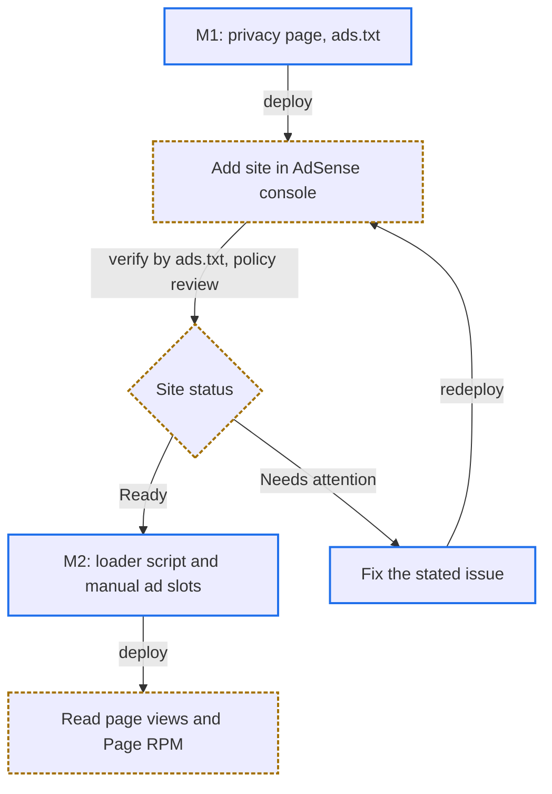

# AdSense 導入計畫

## Quick Navigation

- [目標與範圍](#目標與範圍)
- [流程](#流程)
- [里程碑](#里程碑)
- [驗收範例](#驗收範例)
- [待確認決策](#待確認決策)
- [已知風險](#已知風險)
- [參考資料](#參考資料)

## 目標與範圍

- 目標：在網站放 AdSense **手動版位**，取得廣告收入，並用 AdSense 報表的網頁瀏覽量與 Page RPM 量測流量。
- 範圍內：隱私權政策頁、`ads.txt`、AdSense 載入程式碼、手動版位與其尺寸 CSS、LORE 中英文規則、README 頁面表。
- 範圍外：自動廣告、其他廣告聯播網、直售贊助、聯盟連結、CSP header、移除遊戲圖示。
- 嚴禁啟用自動廣告的頁內格式：[render.js](../public/render.js) 只在頁面載入時對準錨點（角色頁在圖表載入後再對準一次），之後插入的廣告會把錨點目標推離落點。
- AdSense 載入程式碼只放在有版位的頁面。沒有版位的頁面載入它，只會多載入 Google 的程式與 cookie，沒有收益。

[Back to top](#quick-navigation)

---

## 流程

- 實線框（藍）是 repo 內的改動；虛線框（橘）是 AdSense 後台的操作，由站長執行。
- 送審只用 `ads.txt` 驗證網站擁有權，不需要先放載入程式碼。
- 版位在審核通過（Ready）後才加入，避免審核期間頁面出現空白預留區。

[Back to top](#quick-navigation)

---

## 里程碑

每個里程碑完成後送 reviewer 審查，通過後 commit，再進入下一個。

### M1：送審準備

| 檔案 | 改動 |
| --- | --- |
| `public/privacy.html`（新增） | 隱私權政策頁。必須使用共用 `site-header`、先載入 [nav.js](../public/nav.js) 再載入 [render.js](../public/render.js)、`<body data-load="common">`、以有 `id` 的 `h2` 分章。內容必須涵蓋：Google 等第三方廠商使用 cookie 依讀者造訪紀錄放送廣告、讀者可停用個人化廣告的入口、Netlify 主機記錄的請求資訊、聯絡方式。 |
| `public/ads.txt`（新增） | 一行：`google.com, pub-<發布商 ID>, DIRECT, f08c47fec0942fa0` |
| [public/index.html](../public/index.html) | 加入隱私權政策頁入口（位置見決策 D6）。 |
| [README.md](../README.md) | 頁面表新增 `privacy.html` 與 `ads.txt` 兩列。 |
| [LORE.md](../LORE.md)、[LORE_ch.md](../LORE_ch.md) | Site 章新增：隱私權政策頁必須列出網站實際使用的第三方服務。兩份內容必須等價。 |

站長在後台操作：

1. 新增網站，選擇用 `ads.txt` 驗證擁有權。
2. 確認自動廣告為關閉。
3. 在「隱私權和訊息」建立 GDPR 同意訊息（EEA、英國、瑞士）。
4. 送審，等待狀態變成 Ready。

### M2：載入程式碼與手動版位（審核通過後）

| 檔案 | 改動 |
| --- | --- |
| 決策 D3 選定的頁面 | `<head>` 加入 AdSense 載入程式碼（`adsbygoogle.js?client=ca-pub-<發布商 ID>`，`async`）；在決策 D2 選定的位置加入 `<ins class="adsbygoogle <自訂 class>">` 與 `push({})`，上方標示「廣告」。 |
| 版位程式碼 | 嚴禁直接貼上後台產生的預設程式碼：必須刪除 `data-ad-format="auto"` 與 `data-full-width-responsive="true"`，否則廣告會在載入後自行決定高度，手機上還可能比內容欄寬。 |
| 尺寸 CSS | 用自訂 class 加 media query，為每個斷點指定固定寬高（尺寸見決策 D4，CSS 位置見決策 D9）。 |
| [LORE.md](../LORE.md)、[LORE_ch.md](../LORE_ch.md) | Writing Rules 新增版位規則：只用手動版位、固定尺寸、嚴禁放入表格、嚴禁啟用頁內自動廣告、載入程式碼只放在有版位的頁面。 |

站長在後台操作：建立一個多媒體廣告單元，把版位 ID（`data-ad-slot`）提供給我。

[Back to top](#quick-navigation)

---

## 驗收範例

| 條件 | 預期結果 |
| --- | --- |
| 開啟 `https://<網域>/ads.txt` | 回傳 M1 的那一行，HTTP 200。 |
| 開啟 `privacy.html` | 頁首顯示遊戲版本與章節導覽，主控台沒有錯誤，沒有載入 `adsbygoogle.js`。 |
| 視窗寬 280px（內容寬 248px） | 版位為 234×60，頁面沒有橫向捲動。 |
| 視窗寬 400px（內容寬 368px） | 版位為 320×100。 |
| 視窗寬 700px（內容寬 668px） | 版位為 320×100，嚴禁出現 728px 寬的版位。 |
| 視窗寬 760px 以上 | 版位為 728×90。 |
| 廣告載入前後 | `.ad-slot` 的高度不變。 |
| 安裝廣告封鎖器 | 研究數值照常載入；版位依決策 D5 處理。 |
| 廣告延遲 3 秒載入，讀者從 [weapons.html](../public/weapons.html) 的錨點連結進站 | 目標標題仍停在頁首下方，沒有被推走。 |
| EEA 讀者拒絕同意 | 仍能查閱所有研究資料。 |
| 廣告 iframe 插入 `main` 內 | [nav.js](../public/nav.js) 的章節導覽不變（廣告內沒有 `h2`、`h3`）。 |

[Back to top](#quick-navigation)

---

## 待確認決策

| 編號 | 問題 | 選項 | 建議 |
| --- | --- | --- | --- |
| D1 | 網站網域 | `<名稱>.netlify.app` / 自訂網域 | 兩者都可：`netlify.app` 在 Public Suffix List 上，AdSense 接受加入。請提供實際網域。 |
| D2 | 版位位置 | a. `</main>` 之後（頁尾） b. `h1` 說明與第一個 `h2` 之間 c. a + b | a：不影響錨點與 nav.js，但曝光較低。b 曝光高，必須固定高度。 |
| D3 | 放哪些頁面 | 全部頁面 / 只放研究頁（排除首頁、隱私權頁） | 只放研究頁。 |
| D4 | 版位尺寸 | 視窗 <352px：234×60；352–759px：320×100；≥760px：728×90 | 依此。斷點 = 廣告寬 + 左右各 16px 留白，確保 280px 起都不溢出。 |
| D5 | 無廣告（未填充或被封鎖）時 | 保留空白 / 收起 | 頁尾版位可收起；內文版位必須保留，否則會位移。 |
| D6 | 隱私權政策頁入口 | index.html 新增一行 / 每個版位的「廣告」標示旁加連結 / 兩者 | 兩者。 |
| D7 | 遊戲素材權利風險 | 接受並上線 / 先改純文字版 | 由站長決定；本計畫假設接受。 |
| D8 | 同意訊息範圍 | 只 GDPR（EEA、英國、瑞士） / 另加美國州法訊息 | 先只做 GDPR。 |
| D9 | 尺寸 CSS 放哪裡 | a. 每頁 `<head>` 內的 `<style>`（Google 官方做法） b. [public/styles.css](../public/styles.css)（本站慣例，Google 註明不受官方支援） | a：避免因不受支援的寫法導致廣告異常；代價是每頁重複約 10 行。 |

[Back to top](#quick-navigation)

---

## 已知風險

- **遊戲素材權利**：FromSoftware 與 Bandai Namco 的指引只放寬平台官方收益功能，自架網站的廣告不在例外內。
- **審核爬蟲與 JS**：[預先渲染計畫](PRERENDER_PLAN.md) 讓發佈的 HTML 直接含研究數值，主要內容不再依賴 JS。這不保證審核通過；若被判內容不足，可修改後重新送審。
- **報表低估流量**：使用廣告封鎖器的讀者不會載入 AdSense 程式碼，不計入網頁瀏覽量。

[Back to top](#quick-navigation)

---

## 參考資料

- [AdSense 發布商政策](https://support.google.com/adsense/answer/10502938?hl=en)
- [AdSense 隱私權政策必要揭露](https://support.google.com/adsense/answer/1348695?hl=en)
- [AdSense CMP 要求](https://support.google.com/adsense/answer/13554116?hl=en)
- [AdSense 修改響應式廣告程式碼（指定尺寸）](https://support.google.com/adsense/answer/9183363?hl=en)
- [AdSense 網站管理變更（可加入的網域類型）](https://support.google.com/adsense/answer/12170421?hl=en)
- [AdSense ads.txt 說明](https://support.google.com/adsense/answer/12171612?hl=en)
- [Public Suffix List](https://publicsuffix.org/list/public_suffix_list.dat)
- [FromSoftware 影片與圖片投稿指引](https://www.fromsoftware.jp/jp/guidelines_video.html)
- [Bandai Namco Video Policy](https://www.bandainamcoent.co.jp/english/videopolicy/)

[Back to top](#quick-navigation)
