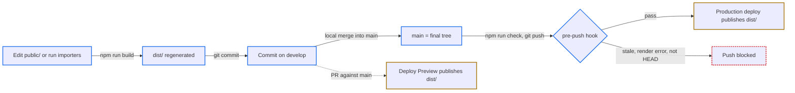

# 預先渲染計畫

## Quick Navigation

- [目標與範圍](#目標與範圍)
- [流程](#流程)
- [設計](#設計)
- [里程碑](#里程碑)
- [驗收範例](#驗收範例)
- [已確認決策](#已確認決策)
- [已知風險](#已知風險)

## 目標與範圍

- 目標：發布的 HTML 直接含完整研究內容，爬蟲與停用 JS 的讀者不必執行 [render.js](../public/render.js) 就能讀到數值；讀者開頁不必等待 data json 載入。
- 資料來源不變：`public/data/*.json` 仍是唯一的權威輸入，HTML 由同一份 render.js 產生，不另寫第二份渲染程式。
- 不綁定主機平台：build 在本機執行，產物 `dist/` commit 進 git；部署只需發布 `dist/`，不需安裝依賴或執行任何指令。
- 範圍內：render.js 拆分、build 腳本、`dist/` 產物、換行設定、pre-push hook、[netlify.toml](../netlify.toml) 發布目錄、[characters.html](../public/characters.html) 說明文字、LORE 中英文規則、README、[ADSENSE_PLAN.md](ADSENSE_PLAN.md)。
- 範圍外：HTML 體積優化、新增資料引用檢查（三個匯入腳本已在寫檔前檢查）、sitemap 等其他 SEO 項目、在 build 時執行 [nav.js](../public/nav.js)。

[Back to top](#quick-navigation)

---

## 流程

- 實線藍框是本機操作；橘框是主機的部署，只發布當次 commit 裡的 `dist/`；虛線是選用的 PR 預覽。
- `public/` 是原始碼：HTML 仍只有骨架與 `data-*` 佔位，開發時仍可用 `python -m http.server -d public` 在瀏覽器渲染預覽。
- `dist/` 是產物：嚴禁手改。每個 commit 的 `dist/` 必須等於該 commit 的建置輸入（`public/`、build 腳本、鎖定的依賴）的輸出。
- 合併進 main 必須在本機完成，並在合併結果上執行 `npm run check` 後再 push。在 GitHub 網頁上合併不會執行本機 hook，產物可能過期，嚴禁用來發布。

[Back to top](#quick-navigation)

---

## 設計

### 依賴與換行

- `package.json` 與 `package-lock.json` 放在 `tools/`，不放 repo 根目錄：主機偵測到根目錄的 `package.json` 會在部署時安裝依賴，放在 `tools/` 可讓部署維持「只發布靜態檔」。
- jsdom 為固定版本的開發依賴。安裝一律用 `npm --prefix tools ci`，依 lockfile 安裝且不修改它。指令：`npm --prefix tools run build`、`npm --prefix tools run check`（下文簡寫為 `npm run build`、`npm run check`）。
- [.gitignore](../.gitignore) 加入 `tools/node_modules/`。
- 新增 `.gitattributes`：`public/` 與 `dist/` 的文字檔在工作目錄固定為 LF，圖片標為 binary。目前本機 `core.autocrlf=true`，文字檔在 repo 是 LF、工作目錄是 CRLF；沒有這項設定，build 寫出的 LF 產物 checkout 後會變成 CRLF，`check` 的逐 byte 比對會誤判過期。

### build 腳本

`tools/build-site.mjs`，build 與 check 共用同一個產生流程。npm 在 `tools/` 執行 script（`node build-site.mjs`），所以腳本依自身的 `import.meta.url` 定位 repo 根目錄（同 [tools/sources.mjs](../tools/sources.mjs)），`public/` 與 `dist/` 一律從 repo 根目錄解析，嚴禁依工作目錄解析。

1. 在記憶體產生完整產物集合（相對路徑 → bytes）：
   - `public/` 的每個檔案原樣讀成 bytes（含 `data/`、`images/`，以及之後新增的 `ads.txt` 等檔案），不做文字解碼。
   - 每個 `public/*.html` 以 jsdom 載入（`runScripts: "outside-only"`，不執行模板內的 script），用讀取本機 `public/data/` 的載入函式執行 render.js 的靜態渲染，在 `<html>` 加上 `data-prerendered`，以 `dom.serialize()` 序列化（保留 doctype）。
2. 任何載入或渲染錯誤：印出頁名與錯誤，以非零狀態結束。此時 `dist/` 尚未被動過。
3. build：全部成功後才清空 `dist/` 並寫入產物集合。
4. check：與磁碟上的 `dist/` 逐檔逐 byte 比對，分別列出缺檔、多出的檔案、內容不同的檔案，有差異就以非零狀態結束；不寫任何檔案。

render.js 沒有使用時間或亂數。輸入 bytes、lockfile 鎖定的依賴與 Node 主要版本固定時，產物必須可重現；以 fresh checkout 後執行 check 驗證。

### render.js 拆成三段

| 段 | 內容 | build | 瀏覽器（已預先渲染） | 瀏覽器（模板預覽） |
| --- | --- | --- | --- | --- |
| 載入資料 | 依 `<body data-load>` 讀取並合併全部資料檔 | 讀本機檔 | 不執行（角色頁與法術轉址另行載入所需檔案） | `fetch` |
| 靜態渲染 | 現有 `render()` 移出 `levelChapter` 後的全部內容，含 `checkLevels`、`labelTableCells` 等檢查 | 執行 | 不執行 | 執行 |
| 互動初始化 | 角色頁 `levelChapter` 與其後續事件；錨點處理 | 不執行 | 執行 | 執行（同現況） |

- 載入與靜態渲染失敗時必須丟出錯誤；只有瀏覽器入口捕捉錯誤並顯示提示。
- `levelChapter` 的 `guarded()` 保留現有行為，保護首次初始化與之後的 change、input、hashchange、ResizeObserver、圖表 pointer 事件；它只在瀏覽器執行，不會吞掉 build 錯誤。

### 角色頁等級章節

- 靜態渲染：用現有 `levelTable()` 為每名角色各輸出一張數值表，每張表以 `<caption>` 顯示由資料產生的角色名稱；保留全部 `character-<角色>-levels` 空錨點。
- 瀏覽器：載入 `common` 與 `characters/nightfarers` 後，只呼叫 `levelChapter` 取代本章，不重跑 `nightfarerChapters()`（否則能力表會重複附加）。
- 載入失敗時保留靜態表，提示文字只說明圖表與切換功能無法使用，不沿用「頁面中的數值無法顯示」。
- 取代後若網址有錨點，沿用現有時序（nav.js 更新頁首高度後）重新對準。
- [characters.html](../public/characters.html) `#levels` 章的說明改寫：圖表、選單與等級控制條是啟用 JS 後的功能。

### 錨點處理（已預先渲染的頁面）

- 本頁找得到錨點目標：交給瀏覽器原生定位，不呼叫 `scrollIntoView`。角色頁例外，見上節。
- 錨點是 `spell-<數字 ID>` 且本頁找不到：載入 `common` 與 `armaments/spells`，依現有 `spellPage()` 的分類轉址：魔法與禱告轉到各自頁面，類型未核實或分歧轉到 `weapons.html`，不存在的 ID 留在本頁。
- 錨點無法解碼：直接忽略。

### pre-push hook（決策 D1）

`.githooks/pre-push`，只檢查推送到 `refs/heads/main` 的更新：

- 被推送的 commit 必須是目前的 HEAD，否則拒絕（例如 `git push origin 舊分支:main`）。刪除 main 的推送一律拒絕。
- 建置輸入與產物沒有未 commit 的變更：`public/`、`dist/`、`tools/build-site.mjs`、`tools/package.json`、`tools/package-lock.json`、`.gitattributes`。
- `npm run check` 通過。
- 其他分支的推送不檢查。hook 只能擋本機 push，不涵蓋在網頁上的合併。

[Back to top](#quick-navigation)

---

## 里程碑

每個里程碑完成後送 reviewer 審查，通過後 commit，再進入下一個。行為與描述該行為的文件在同一個里程碑提交。

### M1：build、產物與文件

| 檔案 | 改動 |
| --- | --- |
| [public/render.js](../public/render.js) | 拆成三段；角色靜態表；預先渲染偵測；錨點處理；互動載入失敗提示。 |
| [public/characters.html](../public/characters.html) | `#levels` 章說明改寫。 |
| `tools/build-site.mjs`（新增） | build 與 check。 |
| `tools/package.json`、`tools/package-lock.json`（新增） | jsdom 固定版本；`build`、`check` 指令。 |
| `.gitattributes`（新增） | `public/`、`dist/` 文字檔 LF，圖片 binary；既有檔案依新設定重新正規化。 |
| [.gitignore](../.gitignore) | 加入 `tools/node_modules/`。 |
| `dist/`（新增，產物） | 首次 build 的結果。 |
| [netlify.toml](../netlify.toml) | `publish = "dist"`，不設 build command；redirects 不變。 |
| [LORE.md](../LORE.md)、[LORE_ch.md](../LORE_ch.md) | Site：來源 `public/`、產物 `dist/`、發布 `dist/`、兩種預覽方式、本機合併與 check 後才 push main。Data：`public/data/` 是權威輸入，`dist/data/` 是發布副本；HTML 骨架規則限定為模板；`data-load` 是完整渲染的相依宣告；反向關係在渲染時計算，可寫進產物 HTML，仍嚴禁存回 JSON。Generation：`dist/` 為產物、嚴禁手改，每個 commit 的 `dist/` 必須等於其建置輸入的輸出；匯入資料後必須重新 build。Pages：角色頁等級章節的靜態表、角色名稱與舊錨點。兩份內容必須等價。 |
| [README.md](../README.md) | 改寫「直接發佈、不需建置」與本機預覽說明；加入 `npm --prefix tools ci` 與 build、check 指令；頁面表補 `tools/build-site.mjs`、`dist/`；render.js 職責改寫。 |
| [ADSENSE_PLAN.md](ADSENSE_PLAN.md) | 「審核爬蟲與 JS」風險改為「主要內容已不依賴 JS」，不寫成保證審核通過；第 18 行嚴禁自動廣告的理由改依新的錨點處理描述。 |

### M2：pre-push hook

| 檔案 | 改動 |
| --- | --- |
| `.githooks/pre-push`（新增） | 依[設計](#pre-push-hook決策-d1)檢查；以可執行模式（`100755`）提交，Git 會忽略沒有可執行位元的 hook。 |
| `.gitattributes` | 加入 `.githooks/pre-push text eol=lf`，避免 `autocrlf=true` checkout 時轉成 CRLF。 |
| [LORE.md](../LORE.md)、[LORE_ch.md](../LORE_ch.md)、[README.md](../README.md) | 每個 clone 執行一次 `git config core.hooksPath .githooks` 啟用 hook。 |

[Back to top](#quick-navigation)

---

## 驗收範例

### build 與 check

| 條件 | 預期結果 |
| --- | --- |
| 修改 `public/` 後執行 build | 與執行前相比，build 新增的變更只在 `dist/`。 |
| 連續執行兩次 build | 兩次的 `dist/` 檔案路徑集合相同，逐檔雜湊相同（不要求修改時間不變）。 |
| 改 `public/` 的 HTML 但沒有重新 build，執行 check | 列出該檔內容不同，以非零狀態結束；不改寫任何產物。 |
| `dist/` 缺一個檔、多一個檔 | check 分別列出缺檔與多出的檔案，以非零狀態結束。 |
| 替換 `public/images/` 的一張圖片 | check 偵測到差異；build 後 `dist/` 的圖片與來源 bytes 完全相同。 |
| 在 `public/` 刪除一頁後 build | `dist/` 不再有該頁。 |
| 武器搭載不存在的法術 ID、戰技不存在、表格欄數不符 | build 印出頁名與原因，以非零狀態結束，`dist/` 不變。 |
| Windows（`core.autocrlf=true`）與 LF 環境各自 fresh checkout，執行 `npm --prefix tools ci` | 不做任何修改，check 通過。 |
| build 完成 | 記錄各頁產物 raw 與 gzip 大小，作為之後優化的基準。 |

### 頁面

| 條件 | 預期結果 |
| --- | --- |
| 停用 JS，開 `dist/weapons.html` | 顯示全部具名武器列（`id="weapon-<id>"`）與數值；頁首顯示遊戲版本。 |
| 停用 JS，開 `dist/relics-general.html` | 遺物詞條、色調 class、來源連結、表格 `role` 與 `data-label` 都在。 |
| 停用 JS，開 `dist/characters.html` | 10 張等級數值表，各以角色名稱為標題；10 個 `character-<角色>-levels` 錨點都在。 |
| 同一頁 build 產物 vs 模板在瀏覽器渲染後 | `<main>` 與頁首版本相同（角色頁等級章節除外）。 |
| 啟用 JS，開 `dist/` 任一頁，網址沒有 `#spell-` 錨點 | 除角色頁外，Network 面板沒有 data json 請求。 |
| 開 `dist/characters.html#character-raider-levels` | 等級章節切換到該角色；按上一頁、下一頁與修改網址錨點時同樣切換。 |
| 開 `dist/characters.html#limitations` | 等級章節換成圖表後，目標標題仍停在頁首下方。 |
| 角色頁的 `characters/nightfarers.json` 載入失敗 | 保留 10 張靜態表；提示只說明圖表與切換功能無法使用。 |
| 開 `dist/weapons.html#spell-<魔法 ID>` | 載入法術資料後轉到 `sorceries.html#spell-<ID>`。 |
| 開 `dist/sorceries.html#spell-<類型未核實的法術 ID>` | 轉到 `weapons.html#spell-<ID>`。 |
| 開 `dist/weapons.html#spell-<不存在的數字 ID>` | 載入法術資料後留在本頁，沒有錯誤。 |
| 開 `dist/weapons.html#%` | 留在本頁，不載入資料，沒有錯誤。 |

### pre-push hook

| 條件 | 預期結果 |
| --- | --- |
| fresh clone 後執行 `git config core.hooksPath .githooks`，推送 `dist/` 過期的 commit 到 main | hook 實際執行並拒絕。 |
| 在 main 上 build、commit 後 `git push origin main` | 通過。 |
| `dist/` 過期的 commit 推送到 main | 拒絕，提示執行 build 並 commit。 |
| 目前 HEAD 正確，但執行 `git push origin 舊分支:main` | 拒絕：被推送的 commit 不是 HEAD。 |
| `tools/build-site.mjs` 或 lockfile 有未 commit 的修改，推送到 main | 拒絕：工作目錄的版本不能替已 commit 的版本背書。 |
| `dist/` 過期，推送到 develop | 不檢查，通過。 |

[Back to top](#quick-navigation)

---

## 已確認決策

| 編號 | 問題 | 決定 | 理由 |
| --- | --- | --- | --- |
| D1 | push 前的防呆 | 加入 M2 的 pre-push hook | 產物進 git 後最大的風險是忘記 build。hook 不能把新 commit 加進正在進行的 push，所以只檢查、不自動 build。 |

[Back to top](#quick-navigation)

---

## 已知風險

- **產物過期**：`dist/` 與建置輸入不同步時，網站發布的是舊內容。由 check 與 hook 防範；在網頁上合併 PR 不受 hook 保護。
- **repo 體積與 diff**：每次改資料或模板，`dist/` 會出現大量 HTML 差異並留在歷史中。圖片與 data json 的內容與 `public/` 相同，git 不會重複儲存同一份內容，但仍增加 tree 項目與工作目錄的副本。
- **HTML 體積**：武器頁與戰技頁的產物估計各約 1.5 MiB（gzip 後數十至約 100 KiB）。這些 DOM 現況也由瀏覽器建立；首屏是否變快必須實測，優化另議。
- **jsdom 與瀏覽器差異**：jsdom 沒有排版，`clientWidth` 為 0，所以圖表只在瀏覽器繪製。靜態渲染使用的 DOM API 必須以全部頁面實際 build 確認。
- **平台設定**：[netlify.toml](../netlify.toml) 的 301 redirects 是 Netlify 專屬格式，搬遷平台時必須改寫成新平台的格式。

[Back to top](#quick-navigation)
